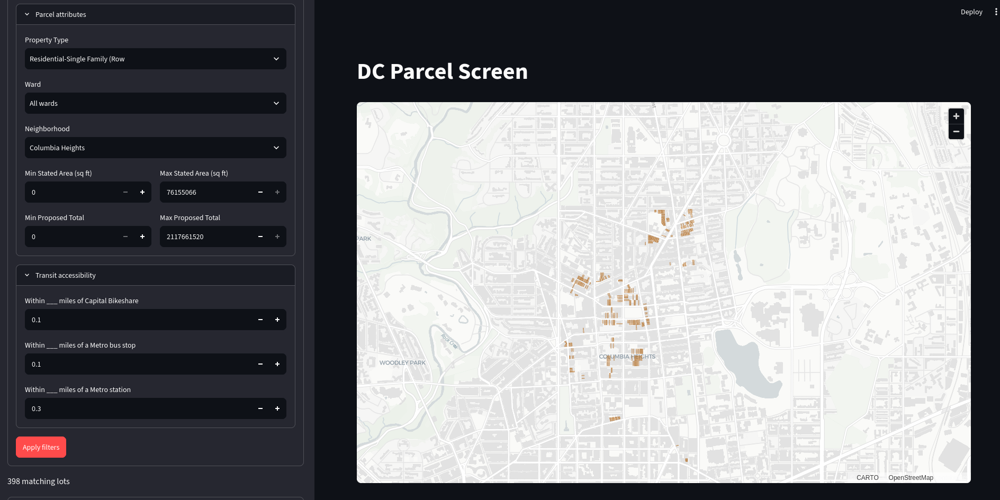

# DC Parcel Screen

DC Parcel Screen is a Python geospatial app built with Streamlit, GeoPandas, and PyDeck for exploring Washington, DC parcels by property attributes and proximity to transit.

## Project overview

I built this tool as a technical introduction to Streamlit. Much of my front-end experience been with JavaScript frameworks like React and Angular. Streamlit is a useful tool for when interactive maps are needed on quick timelines or on an ad-hoc basis. 

The thematic focus on parcel screening  allows me to explore Streamlit's implementation details with a widely generalizable use case. Much of the parcel-level analysis I've performed in my career was, at a high-level, about applying atttibute and spatial filters to identify parcels of interest. As such, this tool serves as a proof-of-concept for a broader class of parcel-level analysis applications. 

In its current form, DC Parcel Screen is most useful as an early-stage screening tool for transit access. However, the same framework can be used to identify parcels near electrical infrastructure, floodplains, or other geographic features.

## What you can do

- Filter parcels by property type, ward, neighborhood, stated area, and proposed total value.
- Optionally limit results by distance to Capital Bikeshare locations, Metro bus stops, and Metro stations. Entering a positive distance activates that layer's filter; zero leaves it off. Active distance filters are combined.
- Select a parcel on the map to inspect its attributes.
- Download matching results as GeoJSON or CSV.

## Example Usage

The attached image shows the results of a query for parcels that are:
- Single family residential (Rowhouse)
- In Columbia Heights
- Are within 0.3 miles of a Metro station
- Are within 0.1 miles of a Capital Bikeshare location
- Are within 0.1 miles of a Metro bus stop



A user can export these results as a CSV or GeoJSON file for further analysis.

## Design decisions

Given the scope of this project, I wanted to keep the backend as simple as possible, while ensuring correctness and scalability. Pursuant to that goal, I made the following design choices:

- **Data Pipeline**: The data pipeline is built around downloading data from Open Data DC, then trimming superfluous columns and simplifying geometries to reduce file sizes. for correct spatial buffering and distance calculations. Lastly, the data is converted to GeoParquet format, which is more efficient for querying than the source GeoJSON format. 
- **GeoPandas Backend**: The app uses GeoPandas for spatial operations and filtering. The tradeoff here is that GeoPandas is not as fast as PostGIS for large datasets, but it is much simpler to set up and maintain. Given the limited scope of the project and the relatively small size of the datasets, this was an acceptable tradeoff.
- **Spatial Proximity Filters**: After attribute filters are applied, parcel geometries are temporarily reprojected to the transit layer's projected CRS (EPSG:32618). The distance limit is converted from miles to meters, and GeoPandas `sjoin_nearest` selects parcels whose geometry is within that straight-line distance of the nearest feature. Results retain the original parcel geometries in EPSG:4326 for mapping and GeoJSON export.

## Data and methodology

| Dataset / local files | Source | Preparation |
| --- | --- | --- |
| DC common-ownership parcels (`Common_Ownership_Lots.geojson` → `Common_Ownership_Lots.parquet`) | [DC Open Data](https://opendata.dc.gov/datasets/1f6708b1f3774306bef2fa81e612a725_40/explore?location=38.894000%2C-77.034607%2C12) (CC BY 4.0; accessed October 14, 2026) | Retain `OBJECTID`, `PROPTYPE`, `STATEDAREA`, `PRMSWARD`, `PREMISEADD`, `NBHDNAME`, and `NEWTOTAL`; simplify geometry by 1 meter in EPSG:32618, then transform back to EPSG:4326; write Zstandard-compressed GeoParquet. |
| Capital Bikeshare locations (`Capital_Bike_Share_Locations.geojson` → `Capital_Bike_Share_Locations.parquet`) | [DC Open Data](https://opendata.dc.gov/datasets/a1f7acf65795451d89f0a38565a975b3_5/explore?location=38.954001%2C-77.097127%2C11) (CC BY 4.0; accessed October 14, 2026) | Retain all columns; reproject to EPSG:32618; write Zstandard-compressed GeoParquet. |
| Metro bus stops (`Metro_Bus_Stops.geojson` → `Metro_Bus_Stops.parquet`) | [DC Open Data](https://opendata.dc.gov/datasets/e85b5321a5a84ff9af56fd614dab81b3_53/explore?location=38.923580%2C-77.046055%2C10) (CC BY 4.0; accessed October 14, 2026) | Retain all columns; reproject to EPSG:32618; write Zstandard-compressed GeoParquet. |
| Regional Metro stations (`Metro_Stations_(Regional).geojson` → `Metro_Stations_(Regional).parquet`) | [DC Open Data](https://opendata.dc.gov/datasets/e3896b58a4e741d48ddcda03dae9d21b_51/explore?location=38.892537%2C-77.020630%2C12) (CC BY 4.0; accessed October 14, 2026) | Retain all columns; reproject to EPSG:32618; write Zstandard-compressed GeoParquet. |


## Run locally

Requires Python 3.14 or newer and `uv`. Clone the repository, enter the project directory, install dependencies, and start the app:

```bash
git clone https://github.com/mark-agard/dc-parcel-screen.git
cd dc-parcel-screen
uv sync
uv run streamlit run src/parcel_screen/app.py
```

The prepared GeoParquet files are included in `data/`, so the preparation step is not needed for normal use. To regenerate them after updating the source GeoJSON snapshots, run `uv run python -m parcel_screen.prepare_data`.

## Validation

Current automated coverage is intentionally small: two Streamlit AppTest user flows using synthetic data, so the large local datasets are not required.

- Confirm zero-distance defaults leave transit filters inactive.
- Combine parcel attributes with a bus-stop distance filter and verify the resulting map feature.

Run with:

```bash
uv run python -m unittest discover -s tests -v
```

## Next steps
Given the app's limitations, I have some thoughts for continued development.

First, I would like to benchmark the app's performance with larger datasets. Depending on how the application handles larger datasets, I might begin development on a duckdb-based backend to handle spatial queries more efficiently.

Assuming a scalable backend is in place, it would be beneficial to add a more robust set of filters to the map. As it stands, the app only supports filtering by parcel attributes and selecting parcels within a certain distance of transit infrastructure. However, it's easy to imagine wanting parcels more than a certain distance from some features.

